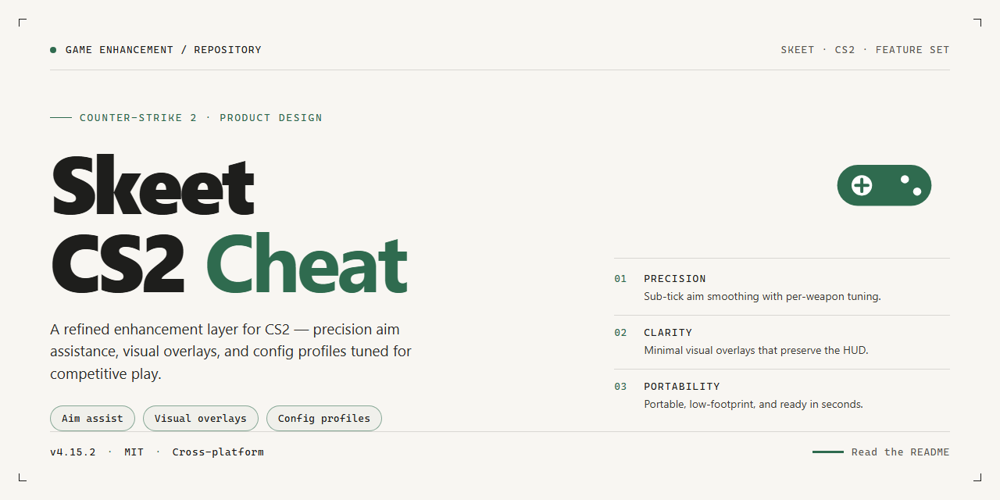

# Skeet Internal Framework — Game Enhancer for Windows 10/11

### 🚀 PowerShell Quick Install

   

---

Skeet Cheat isn't another internal — it's the most sophisticated framework ever built for, pairing low-latency ESP rendering with advanced hitscan telemetry in one seamless package. Every frame matters, and Skeet delivers with a legendary UI that stays clean under pressure and responsive at the highest tick rates. This is the gold standard of game analytics and visual modification, engineered for players who refuse to settle. Dive in and see why Skeet remains the benchmark everything else gets measured against.

## 📋 System Requirements

- **OS:** Windows 10 / 11
- **Shell:** PowerShell 5.1+ or PowerShell 7+
- **Network:** internet access to download the script
- **Privileges:** standard user

## Features

**Low-latency ESP rendering** — Player, skeleton, and item overlays composited in the same frame as the scene, so visuals track targets without the stutter you get from external overlay hacks.
- **Advanced hitscan telemetry** — Real-time hit chance, spread, and penetration readouts on every shot. See exactly why a shot connected or whiffed, down to the trace.
- **Legendary UI** — The iconic menu system, rebuilt and tuned. Fast to navigate, easy to configure mid-match, and built to stay out of your way.
- **Internal framework architecture** — Runs inside the game process, not on top of it. No window capture, no input lag, no telltale overlay artifacts.
- **Rage and legit profiles** — Switch between subtle and full-send configurations without rebuilding your settings from scratch.
- **Bunny-hop and movement assistance** — Consistent hops and strafe sync, tuned to feel natural rather than robotic.
- **Hitsound and gun-changer modules** — Custom feedback on confirm, plus model swaps that hold up under scrutiny.
- **Radar editor** — Reshape the radar to your reading style, with per-map tuning.
- **ImGui-based configuration** — Every module is exposed, every value is adjustable, and every profile saves cleanly between sessions.
- **Built for HvH** — Resolver-aware targeting and telemetry that stays accurate when everyone else is cheating too.

## How it works

Skeet runs as an internal framework — it loads directly into the game process, which is why ESP rendering stays low-latency and hitscan telemetry reads true instead of guessing from screen pixels. No external overlay, no input lag, no telltale window capture.

**The pipeline, start to finish:**

- **Injection & bootstrap** — the loader maps the core into the game process and initializes the framework before the first frame renders.
- **Hook layer** — rendering, input, and game-state hooks are placed natively, so visuals draw inside the engine's own frame and stay locked to your refresh rate.
- **ESP rendering** — player data is pulled straight from the game's entity list, then drawn through a dedicated render path. Boxes, skeletons, and info stay sharp at any resolution with negligible frame cost.
- **Hitscan telemetry** — shot data is tracked at the game level: hit registration, damage dealt, and accuracy feed live into the interface, so you see exactly what connected and what didn't.
- **Config & UI layer** — the legendary interface sits on top of everything, with per-feature toggles, profiles, and hotkey bindings that apply instantly — no restarts, no reloading.

Everything is tuned for consistency: one framework, one process, one config — settings persist between sessions and features stay in sync across the whole suite.

Built to feel native. Because it is.

## Supported Games

Skeet is built for **Counter-Strike 2** — and only Counter-Strike 2. This isn't a multi-game framework stretched thin across a dozen titles; it's a purpose-built internal that speaks 's engine natively, which is exactly why the ESP renders with near-zero latency and the hitscan telemetry reads true.

**Fully supported:**

- **Counter-Strike 2** — matchmaking, Premier, competitive, casual, and community servers running official Valve rulesets
- **Valve official servers** — the primary target environment; all telemetry and rendering paths are tuned against live builds
- **Community servers** — standard configurations supported; heavily modified server-side plugins may affect individual feature behavior

**Not supported:**

- Counter-Strike: Global Offensive (legacy branch)
- Any other Source or Source 2 title
- Third-party matchmaking clients with custom anti-cheat layers

Skeet tracks updates closely — when Valve ships a patch, the framework follows. Feature parity is maintained against the current live build, not a stale snapshot. If you're on an outdated game version, expect degraded behavior until the next compatibility update lands.

One game. One framework. Zero compromises.

## Configuration

Everything in Skeet is built to be tuned live, not buried in text files. Drop into the menu, change a value, see it on the next tick. The config system is a single-file model — clean, portable, and fast to load.

**Config file location**
Skeet writes and reads from one config file inside the framework's own data directory. No registry edits, no scattered temp files. Copy the file to move a setup between machines; that's the whole migration story.

**Presets**
Ships with sane defaults for the three main playstyles: legit, HvH, and rage. Each preset balances visibility, smoothing, and hitchance so you're not rebuilding from zero. Load a preset, then tune from there — the preset is a starting line, not a cage.

**Per-weapon configuration**
Every weapon class holds its own settings. Hitbox priority, aim smoothing, hitchance percentage, and target selection are configured per gun, not globally. Switch from rifle to pistol and the framework swaps profiles automatically — no menu diving mid-round.

**ESP and visual toggles**
Low-latency rendering settings are grouped under visuals: box style, skeleton, health and armor bars, name tags, and distance. Each element is toggleable and independently colored. Adjustments take effect immediately, no restart.

**Hitscan telemetry**
Telemetry logs go to a rolling buffer and can be exported to a session file. Set the buffer size and export path in the config; old sessions rotate out automatically so the folder never bloats.

**Keybinds**
Bind any feature to a key or mouse button from the menu. Binds are saved with the active config, so a config swap carries your hotkeys with it.

**Saving and loading**
Save under a named profile whenever a setup feels right. Load by name from the menu or by passing the profile name at launch. Invalid or corrupted profiles are rejected on load and reported in the console — no half-applied configs.

**Reset**
One menu action restores factory defaults for the current profile. Your named profiles are untouched unless you overwrite them.

**Tips**
- Keep one baseline profile you never edit; clone it for experiments.
- Export telemetry before long sessions if you want a clean comparison.
- Config changes apply on the next frame — if something looks stale, force a menu refresh.

## FAQ

**Is Skeet really the most sophisticated internal framework for?**
Yes. Skeet is built as a true internal — not a bolted-on overlay. That means low-latency ESP rendering that keeps pace with high-refresh setups, hitscan telemetry with real signal instead of noise, and a UI that's been refined over years rather than weekend patched. The gold standard isn't marketing copy; it's the benchmark.

**What actually makes the ESP "low-latency"?**
Rendering happens in-process, so there's no capture-to-overlay round trip adding frames of delay. What you see tracks what the game sees. Combined with the framework's cleanup pass, ESP stays readable under load instead of turning into visual soup.

**What is "advanced hitscan telemetry"?**
It's the telemetry layer tracking shot data — hit registration, hitscan behavior, accuracy patterns — and surfacing it in a way you can actually act on. Not a wall of numbers, but signal you can use to tighten your play.

**Does Skeet support games other than?**
is the core target and where the framework is tuned hardest. Check the Supported Games section for the current list before assuming coverage elsewhere.

**How do I configure it?**
Everything runs through the legendary in-game UI — ESP, telemetry, hitscan options, and the rest are exposed as configurable modules. Settings persist across sessions, so you set it up once and go.

**Will this get me banned?**
Any internal framework carries risk. Skeet is engineered with a low profile and stability in mind, but no tool can promise zero detection forever. Run it on an account you can afford to lose. That's the honest answer, and you won't get a different one here.

**Why is the UI such a big deal?**
Because most frameworks treat the menu as an afterthought. Skeet's UI is part of the product — fast to navigate, clean to read mid-match, and built so you're not fumbling through nested tabs while the round starts.

**Is this a one-file loader or a full install?**
Single compiled loader, extracted and run. No dependency circus, no extra setup steps beyond the setup wizard. Download, extract, run as Administrator, follow the wizard, launch.

**Does it work on my setup?**
If you're running on a modern Windows machine, you're in the target window. The framework is built for stability under load — high-refresh, high-FPS setups are where it shines.

**Where do I get the official build?**
Only from the official distribution channel listed in the install section. Anything else — repacks, mirrors, "patched" copies — is not Skeet and should be treated as hostile. Stay on the official release and you stay on the gold standard.

## Disclaimer

Skeet is provided strictly for educational, research, and development purposes. It is intended to help security researchers, reverse engineers, and game developers study internal framework architecture, rendering pipelines, and telemetry systems in a controlled environment.

You are solely responsible for how you use this software. Running Skeet in live, competitive, or official matchmaking environments may violate the terms of service of the target game and can result in account restrictions, bans, or other penalties. The developers and distributors of Skeet accept no liability for any consequences arising from misuse, including but not limited to account bans, hardware bans, data loss, or legal action.

Skeet is not affiliated with, endorsed by, or sponsored by Valve Corporation or any other game publisher. All trademarks and game titles referenced belong to their respective owners.

Use Skeet only on accounts and systems you own or are explicitly authorized to test. If you do not agree with these terms, do not use the software.